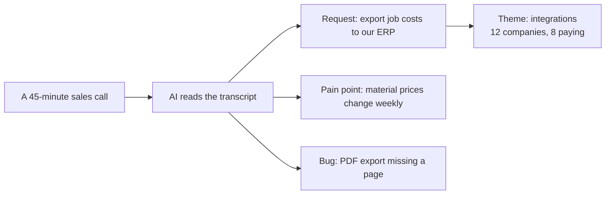
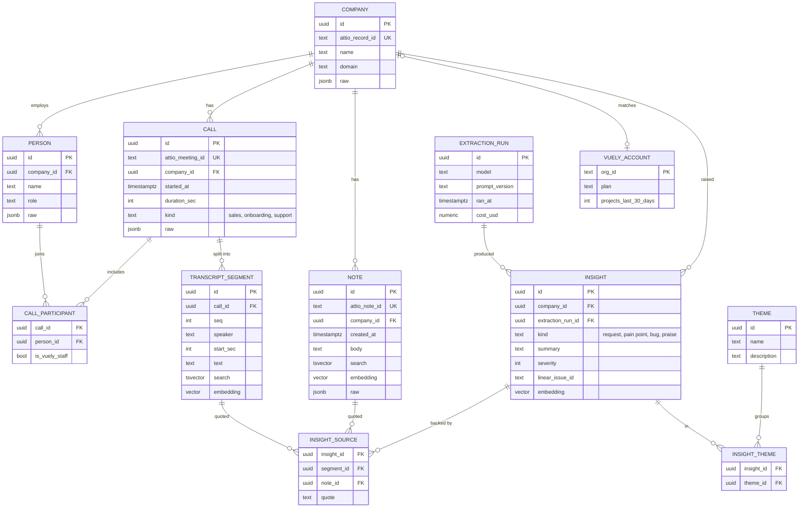
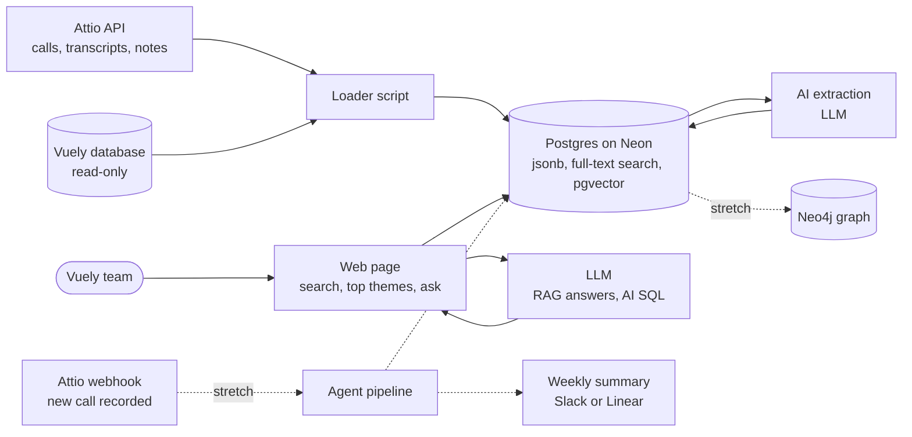

# Customer feedback database: initial design

CS 452 final project, Fall 2026. Alec Zaitz.

## Summary

I cofounded Vuely, a startup that sells software to sign companies (the shops that design, build and install building signs). We record our sales and customer calls in Attio, our CRM. Since June that's 328 calls and 880 notes.

Those calls are full of feature requests and complaints, but they're stuck in transcripts. Nobody on the team can answer questions like:

- What do paying customers ask for most?
- Who asked for this feature, so we can tell them when it ships?
- Which complaints keep coming up across many companies?

This project pulls every call and note into a database, uses AI to turn each request or complaint into its own row, links it to the company and its Vuely account, and lets the team search, rank and ask questions about them.

## Goals

1. Load all Attio calls, transcripts, notes, companies and people into Postgres, keeping each raw API response in a `jsonb` column.
2. Use an LLM to extract requests, pain points and bugs from each call, with the exact quote and timestamp it came from.
3. Link each Attio company to its Vuely account, so insights can be ranked by plan and usage.
4. Embed transcript segments, notes and insights, and group similar insights into themes.
5. Build a web page to search insights, see the top themes, and ask questions:
   - RAG answers a question with quotes and links to the calls they came from.
   - AI SQL turns a question like "requests from paying customers last month" into a SQL query.
6. Measure extraction accuracy against calls I label by hand, and compare full-text search with vector search on the same questions.

Stretch goals:

- An agent pipeline. When a new call is recorded, extract its insights automatically, match them to existing themes and Linear issues, and post a weekly summary for the team.
- Copy companies, insights, themes and Linear issues into Neo4j as a graph, and compare the same queries in Neo4j and Postgres.

## Initial ERD

## Rough system design

## Technology

- **Postgres on Neon.** Relational tables for the data, `jsonb` for raw Attio responses, `tsvector` for full-text search and pgvector for embeddings, all in one database.
- **TypeScript** for the loader and the web page.
- **An LLM API** for extraction, embeddings, RAG answers and AI SQL. I haven't picked a model yet.
- **Neo4j** later, as a stretch goal.

## Daily goals

| Date | Goal |
|---|---|
| Thu 11/19 | Turn in this design. Meet with the professor about scope. |
| Fri 11/20 | Set up Neon and create the tables. |
| Sat 11/21 | Load companies, people and calls from Attio. |
| Mon 11/23 | Load transcripts and notes. Get full-text search working. |
| Tue 11/24 | Write the first extraction prompt and test it on 10 calls by hand. |
| Wed 11/25 | Run extraction on every call. Store the model, prompt version and cost per run. |
| Thu 11/26 | Thanksgiving, no work planned. |
| Fri 11/27 | Link Attio companies to Vuely accounts. |
| Sat 11/28 | Embed transcript segments, notes and insights. Add vector search and compare it with full-text search. |
| Mon 11/30 | Group similar insights into themes using their embeddings. Write the ranking queries. |
| Tue 12/1 | Build the search page and the top themes view. |
| Wed 12/2 | Ask page, part 1: RAG answers with quotes from the calls. |
| Thu 12/3 | Share progress in class. Ask page, part 2: AI SQL. |
| Fri 12/4 | Measure extraction accuracy against hand-labeled calls. Link insights to Linear issues. |
| Sat 12/5 | Stretch: agent pipeline for new calls. |
| Mon 12/7 | Stretch: weekly summary, or the Neo4j graph. |
| Tue 12/8 | Fix what's broken. Take redacted screenshots. |
| Wed 12/9 | Write the final report. |
| Thu 12/10 | Submit. |

## Privacy

Real call data stays in a private database and never goes in this repo. Screenshots and examples in this repo use made-up or redacted company names and quotes.

## Open questions

- Should this be a standalone database or built straight into Vuely's internal admin app?
- Which LLM to use for extraction, and how to keep its cost down?
- How to tell when two insights from different calls are the same request?
- How to keep AI SQL read-only, so a generated query can never change data?
